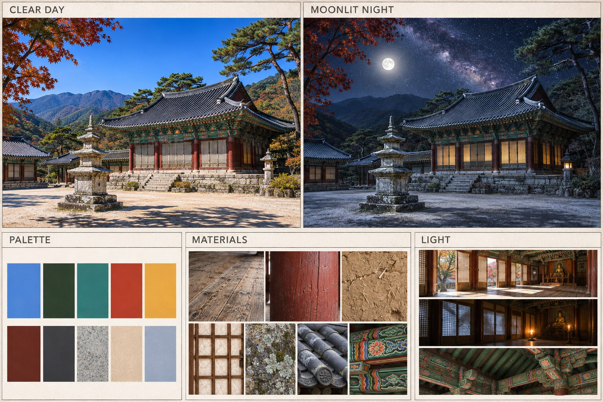

# 청연산사 아트 바이블 v1 (2026-11-05)

- 생성: gpt-image (Codex CLI 내장 이미지 생성), 프롬프트 원문은 `docs/art/prompts/art-bible-v1.txt`.
- 모든 생성형 질감·그림 프롬프트는 이 장을 참조 이미지로 붙이고 아래 방향을 따른다.

## 방향
- **맑은 낮**: 오후 1시 전후, 구름 거의 없는 짙은 파란 하늘, 선명하고 짧은 그림자, 안개 거의 없음, DSLR 사진 같은 자연색·높은 선명도.
- **달밤**: 밝은 보름달 + 달무리, 또렷한 은하수 띠와 수천 개의 별, 은청색 달빛(부드러운 그림자), 지붕선·석탑·나무 줄기가 실루엣으로 늘 읽힐 것. 지평선은 옅은 남빛. 창호·석등은 작고 따뜻한 호박색 점.
- **실내**: 낮은 열린 창호로 들어온 햇빛이 마루에 떨어지는 빛 웅덩이, 밤은 촛불 + 창호 너머 달빛, 천장 귀퉁이의 부드러운 그늘(AO).
- **재질**: 오래된 소나무 마루(칠 없음), 결이 보이는 석간주 기둥, 짚 섞인 흙벽, 나무 살대에 바른 한지, 이끼 낀 화강암, 먹회색 기와, 단청 띠(뇌록·주홍·석황).

## 팔레트 (시트 색칩 평균값)
| 이름 | HEX |
|---|---|
| 하늘 파랑 | `#4C84D6` |
| 솔잎 진녹 | `#30402E` |
| 단청 뇌록(청록) | `#327876` |
| 단청 주홍 | `#B7402A` |
| 석황(황토) | `#E8A844` |
| 석간주 | `#672C21` |
| 기와 먹회색 | `#3E3E41` |
| 화강암 회색 | `#A19E99` |
| 마사토 베이지 | `#DFC6AB` |
| 달빛 은청 | `#9EA9BD` |
